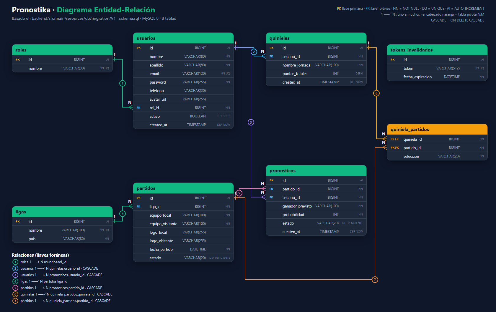

# Pronostika

Plataforma web full-stack de pronósticos deportivos, análisis táctico y quinielas de fútbol. Desarrollada con **Spring Boot 4**, **MySQL 8**, **Flyway**, **React 19 + Vite + Tailwind CSS 4**, **ESPN API**, **Gemini AI** y **Twilio (WhatsApp / SMS)**.

- **Despliegue en producción (Vultr VPS):** `http://216.238.94.85:8088`

## Tecnologías

| Capa | Tecnologías |
|------|-------------|
| Backend | Java 17, Spring Boot 4, Spring Data JPA, Spring Security + JWT, Bean Validation, Flyway, Spring Mail, Twilio SDK 10.6 |
| Base de datos | MySQL 8.0 (`pronostika_db`, 8 tablas gestionadas con Flyway) |
| Frontend | React 19, Vite, Tailwind CSS 4, Axios, lucide-react |
| Integraciones | ESPN Public Sports API, Google Gemini AI, Gmail SMTP, Twilio WhatsApp/SMS Sandbox |
| Infraestructura y Pruebas | Ubuntu + Nginx + systemd (`deploy/`), JUnit 5 (`backend/src/test/`), Bruno (`bruno/`) |

## Estructura del repositorio

```
pronostika-fullstack/
├── backend/                 API REST (Spring Boot + Flyway + JUnit 5)
├── frontend/                SPA en React + Vite + vistas estilo Sofascore
├── bruno/                   Colección completa de pruebas HTTP (01-auth a 07-sports-ia)
├── database/diagrama-er.png Diagrama entidad-relación
├── deploy/                  Configuración Nginx, unidad systemd y script de despliegue VPS
└── docs/                    Guías técnicas (Twilio WhatsApp Sandbox)
```

## Base de datos

El esquema lo crea Flyway mediante `V1__schema.sql` con 8 tablas: `roles`, `usuarios`, `ligas`, `partidos`, `pronosticos`, `quinielas`, `quiniela_partidos` (tabla pivote N:M) y `tokens_invalidados`.



## Puesta en marcha local

### 1. Base de datos

```sql
CREATE DATABASE pronostika_db CHARACTER SET utf8mb4 COLLATE utf8mb4_unicode_ci;
```

### 2. Backend

1. Copia `backend/src/main/resources/application.properties.example` como `application.properties` (ignorado en Git).
2. Completa tus credenciales de MySQL, `jwt.secret`, correo SMTP, `gemini.api-key` y Twilio Sandbox.
3. Ejecuta desde `backend/`:

```bash
./mvnw spring-boot:run          # Linux / macOS
mvnw.cmd spring-boot:run        # Windows (PowerShell / CMD)
```

Para ejecutar las pruebas unitarias:

```bash
cd backend
./mvnw test
```

### 3. Frontend

```bash
cd frontend
npm install
npm run dev
```

## Endpoints principales de la API

Todas las respuestas utilizan DTOs y manejo global de errores (`{ timestamp, status, error, mensaje, ruta, campos }`).

### Autenticación y verificación (`/api/auth`)

| Método | Ruta | Descripción |
|--------|------|-------------|
| POST | `/api/auth/login` | Inicio de sesión y emisión de token JWT |
| POST | `/api/auth/register` | Registro de usuario con contraseña segura |
| POST | `/api/auth/logout` | Cierre de sesión e invalidación del JWT |
| POST | `/api/auth/email/enviar-codigo` | Envío de código OTP de verificación por correo |
| POST | `/api/auth/email/verificar-codigo` | Validación de código OTP |
| POST | `/api/auth/recuperar-password` | Solicitud de código de recuperación |
| POST | `/api/auth/restablecer-password` | Cambio de contraseña mediante código temporal |

### Pronósticos e Inteligencia Deportiva (`/api/pronosticos`, `/api/sports`)

| Método | Ruta | Descripción |
|--------|------|-------------|
| GET | `/api/pronosticos?page=0&size=10&liga=&search=` | Listado paginado y filtrado de pronósticos |
| POST | `/api/pronosticos` | Alta de pronóstico (`ADMIN` / `ANALISTA`) |
| PUT | `/api/pronosticos/{id}` | Edición de pronóstico (`ADMIN` / `ANALISTA`) |
| DELETE | `/api/pronosticos/{id}` | Eliminación de pronóstico (`ADMIN` / `ANALISTA`) |
| GET | `/api/sports/match-details` | Plantillas y últimos 5 resultados reales desde ESPN |
| POST | `/api/sports/ai-analysis` | Análisis táctico generado con Gemini AI |

### Administración de usuarios (`ROLE_ADMIN`)

| Método | Ruta | Descripción |
|--------|------|-------------|
| GET | `/api/admin/usuarios?buscar=&page=0&size=10` | Listado paginado con búsqueda |
| GET | `/api/admin/usuarios/roles` | Roles disponibles |
| POST / PUT / PATCH / DELETE | `/api/admin/usuarios` | Alta, edición, cambio de rol y baja |

### Quinielas y Perfil (usuario autenticado)

| Método | Ruta | Descripción |
|--------|------|-------------|
| GET | `/api/quinielas?page=0&size=10` | Historial de quinielas del usuario |
| GET | `/api/quinielas/{id}` | Detalle de partidos y selecciones |
| POST | `/api/quinielas` | Guarda quiniela N:M y envía confirmación por WhatsApp/SMS |
| GET / PUT | `/api/perfil` | Consulta y edición de teléfono (WhatsApp/SMS) y avatar |

## Notificaciones y Despliegue

- **Twilio WhatsApp / SMS:** consulta la guía en [`docs/twilio-whatsapp.md`](docs/twilio-whatsapp.md).
- **Despliegue en Vultr VPS:** consulta [`deploy/README.md`](deploy/README.md).

## Pruebas con Bruno

1. Abre Bruno -> *Open Collection* -> carpeta `bruno/`.
2. Selecciona el entorno **Local** o **Produccion-VPS** y configura las contraseñas secretas.
3. Ejecuta `01-auth` para obtener el JWT y prueba las carpetas `02` a `07`.

## Equipo

| Integrante | Módulos |
|------------|---------|
| Carlos Yahel Alemán Cruz | Arquitectura full-stack, Flyway, Auth/OTP, Pronósticos CRUD, ESPN + Gemini AI, integración Sofascore/Quiniela/WhatsApp, despliegue VPS Vultr |
| Mario Eduardo Grajales Ramírez | Admin de usuarios, quinielas, perfil, Twilio base, plantillas de correo, vistas Sofascore, diagrama ER, colección Bruno inicial |
